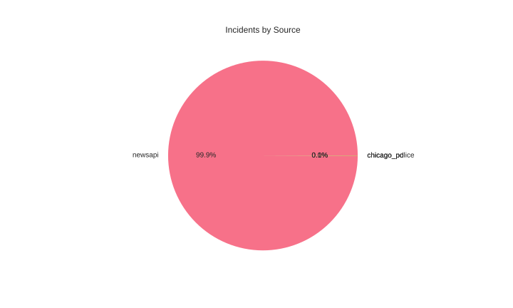

Loaded 149017 incidents
Date range: 2024-01-01 00:00:00 to 2026-11-13 17:50:46

Incidents by source:
source
newsapi           148916
chicago_pd           100
chicago_police         1
Name: count, dtype: int64

Report saved to reports/latest_analysis.md
ion.svg)

## Source Distribution

## Crime Types

## Recent Incidents

### HOMICIDE on 2026-11-13 17:50
- Location: The Times of India
- Description: Mumbai police upgraded charges to murder against 28-year-old Abhishek Karande after his mother died from head injuries in a Goregaon assault.

### OTHER on 2026-11-13 17:49
- Location: Breitbart News
- Description: Authorities Thursday revealed the cause of the perplexing accident involving a Kansas mom who fatally crashed her truck into a soccer game: the woman was taking a nap behind the wheel of her parked truck only to wake up inside a runaway vehicle and a real lif…

### HOMICIDE on 2026-11-13 17:48
- Location: Dailymail.com
- Description: Alex Murdaugh argued that the murder indictments should be tossed because they the lead investigator lied to the grand jury about blood spatter evidence tying him to the murders.

### OTHER on 2026-11-13 17:48
- Location: Abcnews.com
- Description: Judges at the International Criminal Court have ended the part of the global tribunal’s investigation into Afghanistan that could have involved U.S. military personnel

### OTHER on 2026-11-13 17:48
- Location: Dailymail.com
- Description: I am bewildered as to why Bake Off is still accommodating and feting the alleged comedian.

Analysis generated at: Sat Nov 14 17:51:40 UTC 2026
