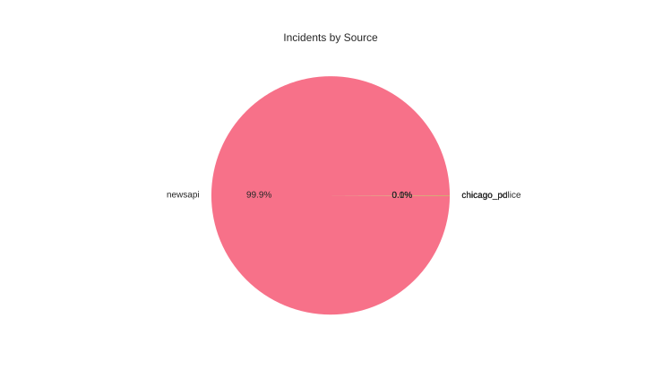
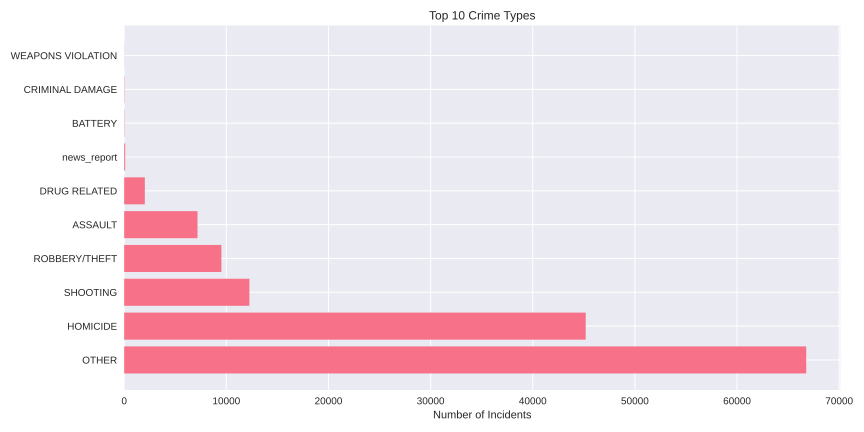

Loaded 143027 incidents
Date range: 2024-01-01 00:00:00 to 2026-10-23 10:05:45

Incidents by source:
source
newsapi           142926
chicago_pd           100
chicago_police         1
Name: count, dtype: int64

Report saved to reports/latest_analysis.md
ion.svg)

## Source Distribution

## Crime Types

## Recent Incidents

### OTHER on 2026-10-23 10:05
- Location: The Times of India
- Description: Peter Arnold, affectionately dubbed 'Mr Spitfire', dedicated over half a century to amassing historic aircraft relics. After his passing in 2025, a remarkable unfinished Spitfire fuselage went under the hammer for £18,000. This Spitfire F Mk 22 PK519 fuselage…

### OTHER on 2026-10-23 10:00
- Location: Salon
- Description: The deal is built to prevent future presidents and Venezuelan leaders from changing or dismantling the enterprise

### HOMICIDE on 2026-10-23 10:00
- Location: Fox News
- Description: A Utah Supreme Court appeal in the Gabby Petito wrongful death case could clear the way for Charlie Kirk's family to sue over security failures.

### OTHER on 2026-10-23 10:00
- Location: TechRadar
- Description: Here's how to watch the new detective drama online from anywhere in the world FOR FREE.

### SHOOTING on 2026-10-23 10:00
- Location: The New Yorker
- Description: Rachel Monroe writes about Meta’s law-enforcement-outreach team, and about those who monitor social media in an effort to prevent school shootings and other acts of violent extremism.

Analysis generated at: Sat Oct 24 10:08:13 UTC 2026
