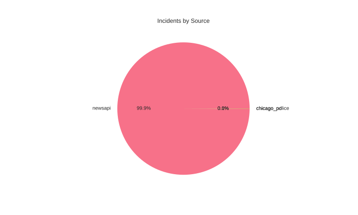
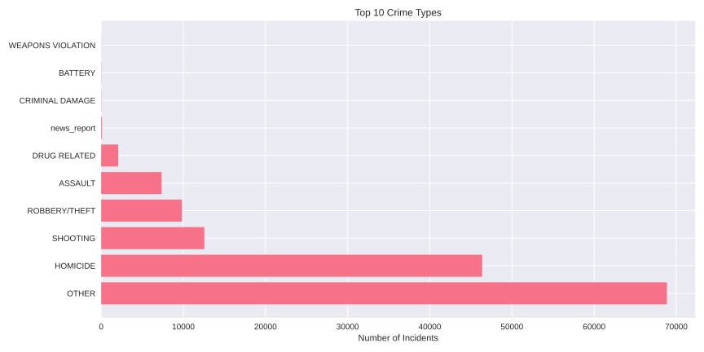

Loaded 145772 incidents
Date range: 2024-01-01 00:00:00 to 2026-11-02 00:16:44

Incidents by source:
source
newsapi           145671
chicago_pd           100
chicago_police         1
Name: count, dtype: int64

Report saved to reports/latest_analysis.md
ion.svg)

## Source Distribution

## Crime Types

## Recent Incidents

### SHOOTING on 2026-11-02 00:16
- Location: Dailymail.com
- Description: A Georgia father has been arrested on manslaughter charges after his young son got hold of a gun and fatally shot himself.

### HOMICIDE on 2026-11-02 00:15
- Location: BBC News
- Description: There were hundreds of arrests as protesters took to the streets in cities across France for the third weekend in a row.

### ROBBERY/THEFT on 2026-11-02 00:10
- Location: Dailymail.com
- Description: There was a sordid secret in Thomas Markle's Mexican storage unit. Now the world knows about it. So does the FBI.

### SHOOTING on 2026-11-02 00:07
- Location: The Punch
- Description: Gunmen suspected to be kidnappers have abducted a 100-level female student of Plateau State University, Bokkos, while another person sustained injuries during an attack on off-campus student residential areas in Bokkos Local Government Area of Plateau State. …

### HOMICIDE on 2026-11-02 00:07
- Location: The Punch
- Description: The Ogun State Police Command has foiled a suspected robbery operation in Ijaba, Iyesi, Ota, killing one suspected gang member and recovering two vehicles, two pistols and several other items believed to have been stolen. The incident reportedly occurred in t…

Analysis generated at: Tue Nov  3 00:22:19 UTC 2026
