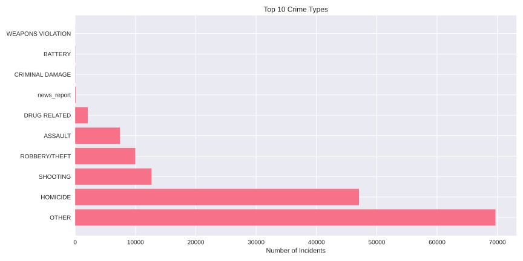

Loaded 149226 incidents
Date range: 2024-01-01 00:00:00 to 2026-11-15 04:02:24

Incidents by source:
source
newsapi           149125
chicago_pd           100
chicago_police         1
Name: count, dtype: int64

Report saved to reports/latest_analysis.md
ion.svg)

## Source Distribution

## Crime Types

## Recent Incidents

### OTHER on 2026-11-15 04:02
- Location: CBS News
- Description: When Susan "Phoenix" Lane and her two dogs went missing from Welches, Oregon, in the foothills of Mount Hood, her friends and family suspected foul play almost immediately.

### OTHER on 2026-11-15 02:44
- Location: Freerepublic.com
- Description: A former Wyoming VFW commander accused of stealing his own war helmet had no idea there was a felony warrant for his arrest until he was taken into custody at an airport in front of his family. Richard Knapp, 59, told Cowboy State Daily in a Friday phone inte…

### SHOOTING on 2026-11-15 02:38
- Location: Dailymail.com
- Description: The shooting happened Saturday afternoon at the South Carolina Arms Collector Association's gun and knife show in Columbia, roughly 100 miles northwest of Charleston.

### OTHER on 2026-11-15 02:31
- Location: Freerepublic.com
- Description: Police data shows imported practices hitting girls and women at the highest level on record ... Police in England and Wales recorded 3,145 honour-based abuse offences in the year ending March 2026 — the highest figure since comparable records began. Female ge…

### HOMICIDE on 2026-11-15 02:30
- Location: Thegatewaypundit.com
- Description: According to court records, a man who called the sheriff to investigate a burglary at his residence was arrested after authorities found his mother deceased in the home.
The post Man Allegedly Beats Mother to Death, Attempts to Cover it Up with Fake Burglary …

Analysis generated at: Mon Nov 16 04:18:45 UTC 2026
